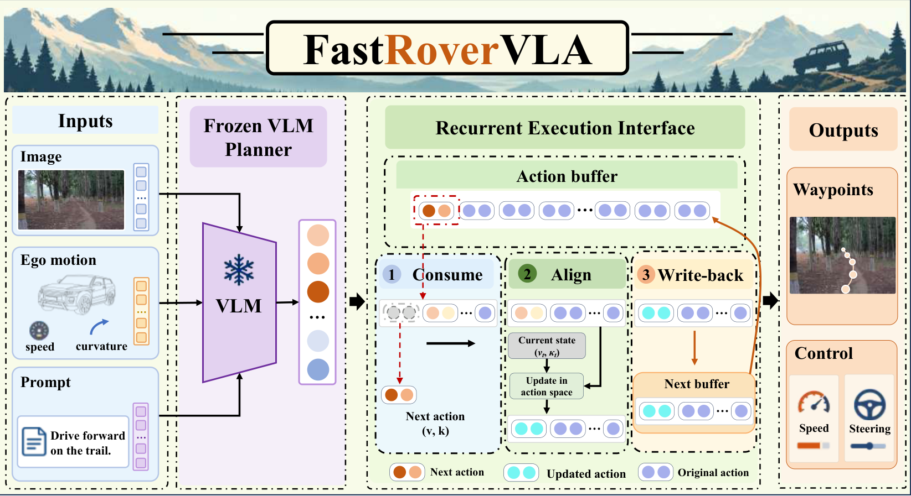
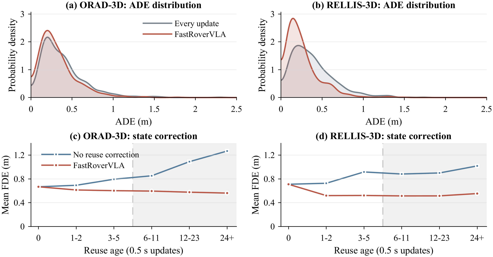

<div align="center">

# FastRoverVLA

### Fast Vision-Language-Action Execution for Off-Road Autonomous Driving

**Plan less. Stay in sync.**

[Project Page](https://chang2tz.github.io/FastRoverVLA/) · [Quick Start](#quick-start) · [Method](docs/method.md) · [Reproduction](docs/reproduction.md) · [Citation](#citation)


Changtao Zhao · Yingxue Guan · Li Wang · Ziying Song  
Shijie Zhao · Yuhang Zhang · Shengkai Zhang · Qing Wang

</div>

FastRoverVLA decouples visual plan generation from motion-conditioned execution.
It maintains decoded speed–curvature actions with **recurrent state alignment and
correction write-back**, while a bounded plan-variation rule controls refresh demand.
The execution interface is training-free and does not access backbone features.



## News

- **2026-11-04** — Initial source package: execution core, full-precision Qwen3 configurations,
  a 1,286-window numerical replay bundle, component controls and the project page.
- The research manuscript is being prepared for submission. Its public paper link and
  bibliographic entry will be added when available.

## What is released

- **Execution core:** a model-agnostic Python callback interface with stateful corrected buffers.
- **Refresh policy:** every-update, fixed and validation-calibrated adaptive schedules.
- **Numerical replay:** 636 ORAD-3D and 650 RELLIS-3D windows with frozen decoded predictions,
  logged scalar states, scoring targets and reference outputs.
- **Controls:** matched-refresh no-reuse correction, stale reuse, alignment/write-back/blend/
  bound ablations, plan-source controls and persistent motion-only execution.
- **Verification:** trajectory-level parity, full-precision metrics, schedules and checksums.
- **Project page:** responsive static source with an interactive numerical trajectory explorer.

This package releases the execution method and a reproducible numerical subset of the
paper experiments. Backbone weights, raw datasets and the original multi-backbone GPU
inference runtime are not bundled. [Release and evaluation scope](docs/evaluation.md).

## Quick start

The core and numerical reproduction require only Python 3.10+; no GPU is needed.

```bash
git clone https://github.com/chang2tz/FastRoverVLA.git
cd FastRoverVLA
python -m pip install --no-deps -e .

# Synthetic callback example
python -m fastrovervla demo --steps 24

# Recompute paper-facing replay and verify the archived trajectories
python scripts/reproduce.py --verify
```

Expected verification: **1,286 windows**, **37 / 31 adaptive admissions** on ORAD / RELLIS,
and a maximum primary-trajectory coordinate difference below `1e-12`.
Outputs are written to `results/reproduction/`.

See [installation](docs/installation.md) for offline setup and backbone integration.

## Method

1. **Initialize:** complete the decoded action horizon and blend a fresh visual plan
   with measured motion.
2. **Align:** correct every action against current measured speed and curvature,
   including at refresh; apply the speed-step bound.
3. **Integrate:** produce six ego-relative waypoints at 0.5 s spacing.
4. **Consume and write back:** remove the first action and retain the corrected tail.
5. **Refresh:** select a short or long reuse budget from validation-normalized variation
   in the unpadded decoded plan.

`K` counts reuse updates, so a complete refresh interval contains **K + 1** updates.
The output horizon and refresh interval are separate quantities.
Use the [full method specification](docs/method.md) and exact JSON configurations.

### Plug in a frozen planner

```python
from fastrovervla import FastRoverPolicy, FrameContext

policy = FastRoverPolicy()

def planner(context):
    # Replace with your model's decoded (speed_mps, curvature_m_inv) actions.
    return [(1.2, 0.02)] * 6

result = policy.step(
    FrameContext("scene-001", speed_mps=1.0, curvature_m_inv=0.01,
                 observation=None, instruction="Follow the trail."),
    planner,
)
print(result.refreshed, result.waypoints)
```

The callback runs **only at refresh**, with no new visual inference during reuse.
See [integration](docs/integration.md) for units, sequence resets and output handling.

## Primary results

### Controlled frozen-prediction replay

Qwen3-VL-2B; six points / 3 s; errors in metres, lower is better.
The released CPU bundle reproduces this table.

| Dataset | Execution | ADE ↓ | FDE ↓ | Admissions / updates | Refresh rate ↓ |
|---|---|---:|---:|---:|---:|
| ORAD-3D | Every update | 0.384 | 0.726 | 636 / 636 | 100.0% |
| | Fixed interval | 0.330 | 0.599 | 52 / 636 | 8.2% |
| | **FastRoverVLA** | **0.327** | **0.593** | **37 / 636** | **5.8%** |
| RELLIS-3D | Every update | 0.387 | 0.820 | 650 / 650 | 100.0% |
| | Fixed interval | 0.289 | 0.584 | 74 / 650 | 11.4% |
| | **FastRoverVLA** | **0.266** | **0.526** | **31 / 650** | **4.8%** |

These admissions read frozen predictions, with **zero model requests during replay**.
Targets preserve the archived scoring convention. The separate RELLIS past-only-heading
check gives approximately **0.316 / 0.606 m** ADE/FDE while holding predictions and
schedules fixed; [reference-frame details](docs/reproduction.md#reference-frame-check).

### Independent actual-request runs

Archived paper results from separate serial GPU runs with Qwen3-VL-2B:

| Dataset | Execution | ADE ↓ | FDE ↓ | Requests / update ↓ | Wrapper ms / update ↓ |
|---|---|---:|---:|---:|---:|
| ORAD-3D | Every update | 0.385 | 0.727 | 100.0% | 355.4 |
| | **FastRoverVLA** | **0.328** | **0.596** | **6.0%** | **21.4** |
| RELLIS-3D | Every update | 0.391 | 0.831 | 100.0% | 443.9 |
| | **FastRoverVLA** | **0.266** | **0.526** | **4.8%** | **21.3** |

The 16.6x / 20.8x ratios describe measured **request-processing cost per logged update**.
They are not asynchronous speedup, vehicle control rate or complete sensor-to-actuator
latency. The CPU command does not repeat these GPU measurements.

### What the controls show



Persistent state correction explains most of the accuracy benefit. A persistent
motion-only control is competitive, including lower RELLIS error in the primary
replay, and equal-budget uniform refresh is close to the plan-conditioned rule.
The release exposes these controls and their protocol instead of attributing every
gain to visual semantics. [Reproduce the controls](docs/reproduction.md#controls).

## Repository map

```text
src/fastrovervla/     Execution, refresh, geometry, replay and CLI
configs/             Frozen full-precision Qwen3 settings
data/benchmark/      Numerical traces, references and provenance
examples/            Planner callback example
scripts/             Reproduction, site export and validation
tests/               Execution contract and edge cases
docs/                Method, protocol and integration guides
docs/site/           GitHub Pages source and manuscript figures
.github/workflows/   CPU validation and Pages deployment
```

## Project page

```bash
python scripts/export_site_data.py
python scripts/check_site.py
python -m http.server 8765 --directory docs/site
```

Open `http://localhost:8765/`. Deployment is configured for GitHub Actions;
[publishing instructions](docs/publishing.md).

## Citation

Please cite the software release until a public paper record is available:

```bibtex
@software{fastrovervla2026,
  author = {Zhao, Changtao and Guan, Yingxue and Wang, Li and
    Song, Ziying and Zhao, Shijie and Zhang, Yuhang and
    Zhang, Shengkai and Wang, Qing},
  title = {FastRoverVLA: Fast Vision-Language-Action Execution
    for Off-Road Autonomous Driving},
  year = {2026},
  version = {0.1.0},
  url = {https://github.com/chang2tz/FastRoverVLA}
}
```

## License and acknowledgements

Original code is released under the [MIT license](LICENSE). Dataset-derived artifacts,
imagery and upstream models retain their own terms; see [THIRD_PARTY.md](THIRD_PARTY.md).
We thank the ORAD-3D, RELLIS-3D and open VLM communities. Repository presentation draws
inspiration from [MomAD](https://github.com/adept-thu/MomAD),
[KineWorld](https://github.com/modaxiansheng/KineWorld), and
[EVEWorld](https://github.com/behappya/EVEWorld); their scientific content and media are
not part of this release.
